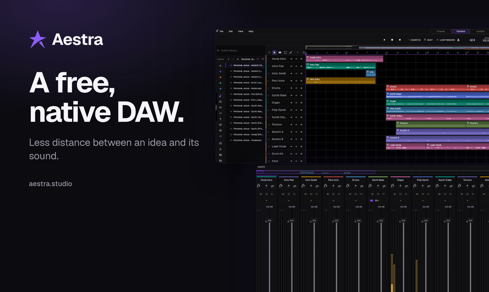
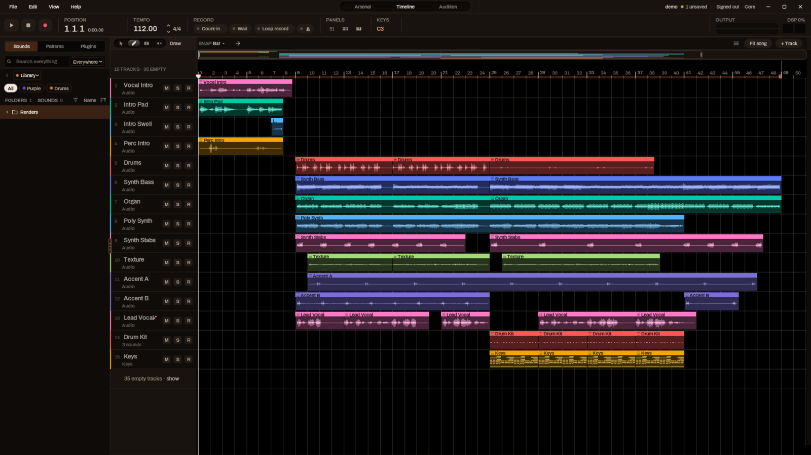
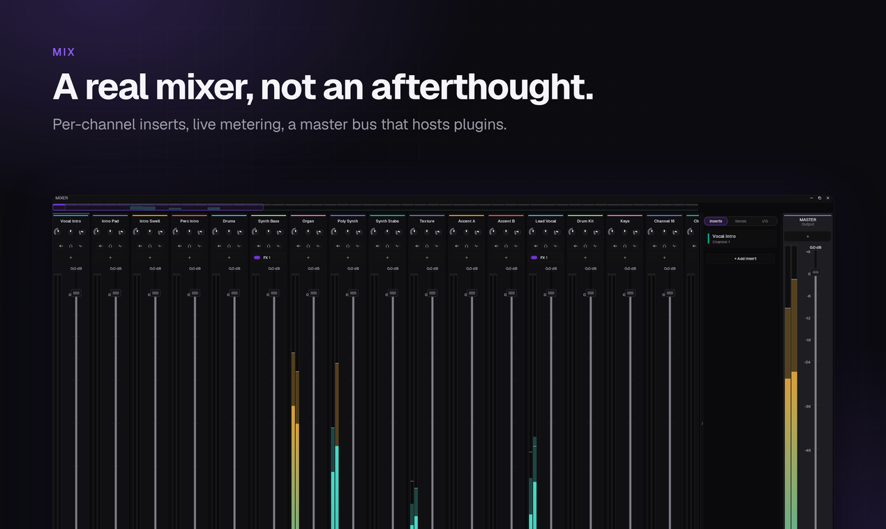
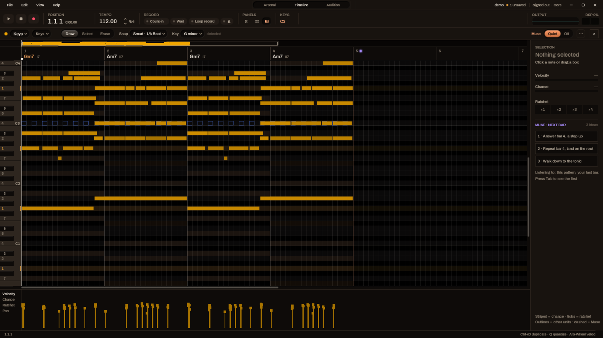

# Aestra


**Make music, not excuses.**

Aestra is a digital audio workstation built for people who want capable music-making tools without needing expensive hardware or expensive software. It combines a native audio engine with a custom interface, designed to stay responsive on modest computers while giving producers room to grow.



## What is Aestra?

Aestra is built around a simple idea: making music should not mean fighting your tools first.

It brings arrangement, recording, MIDI, instruments, effects, mixing, and rendering into one workspace. Its custom C++ engine and UI are developed together, giving us control over the experience from the audio callback to the smallest interface detail.

We're also building around something beyond making music: protecting the work that goes into it. Your projects should remain yours, your work should be recoverable, and your tools should never hold your music hostage.

## See Aestra

Real captures of the running application.

| Arrangement | Mixer |
| --- | --- |
|  |  |



## Built to work with you

**A native audio engine.** Aestra is built in C++17, with its own audio engine, DSP, plugin hosting, and custom GPU-accelerated interface.

**A focused production workflow.** Arrange audio and patterns, write MIDI, work with instruments and effects, mix, and render your music.

**Muse.** Aestra exposes a scriptable control surface that lets you interact with a running application through the same command system used by its interface. This also makes it possible for external tools and AI agents to work with projects.

For example:

```bash
muse list_units
muse set_bpm --value 140
muse render_pattern --pattern 1 --file /tmp/loop.wav
```

**Your work stays yours.** Aestra is designed around local-first projects, accessible recovery, and the ability to take your music elsewhere.

## Development status

Aestra is actively developed and remains in its pre-beta 0.x phase. Features, workflows, and interfaces are still evolving. Expect rough edges, incomplete areas, and breaking changes.

Current desktop development targets are Windows and Linux. Engine CI also covers macOS, but that does not mean a supported macOS application is available.

Aestra is not yet recommended as the sole home for critical production work. Back up your projects and exports.

## Building

Aestra uses CMake and requires a C++17-compatible toolchain.

```bash
git clone https://github.com/currentsuspect/Aestra.git
cd Aestra

cmake -S . -B build \
  -DAestra_CORE_MODE=ON \
  -DAESTRA_ENABLE_TESTS=ON \
  -DCMAKE_BUILD_TYPE=Release

cmake --build build --parallel
```

Run the test suite:

```bash
ctest --test-dir build --output-on-failure
```

For platform dependencies, UI build requirements, configuration options, and troubleshooting, see the [Build Guide](docs/getting-started/building.md).

## Documentation

- [Documentation home](docs/README.md)
- [Build guide](docs/getting-started/building.md)
- [Contributor guide](docs/developer/contributing.md)
- [Testing and CI](docs/technical/testing_ci.md)
- [Engineering health](docs/technical/engineering-health.md) — the properties a change must not break
- [Audio engine ownership](docs/technical/audio/AUDIO_ENGINE_OWNERSHIP.md) — who owns an engine, and who only borrows one
- [Changelog](CHANGELOG.md)

Published documentation: https://currentsuspect.github.io/Aestra/

## Contributing

Aestra is developed in the open, and contributions are welcome.

Before making changes, read [CONTRIBUTING.md](CONTRIBUTING.md) and the [contributor guide](docs/developer/contributing.md).

## License

Aestra is source-available under the Aestra Studios Source-Available License (ASSAL) v1.1.

The source code is publicly readable, but it is **not open-source software and is not freely usable**. Read the license before using, modifying, or distributing the code.

- [LICENSE](LICENSE) — the authoritative license
- [LICENSING.md](LICENSING.md) — a plain-language explanation
- [NOTICE](NOTICE) — third-party notices and attributions
